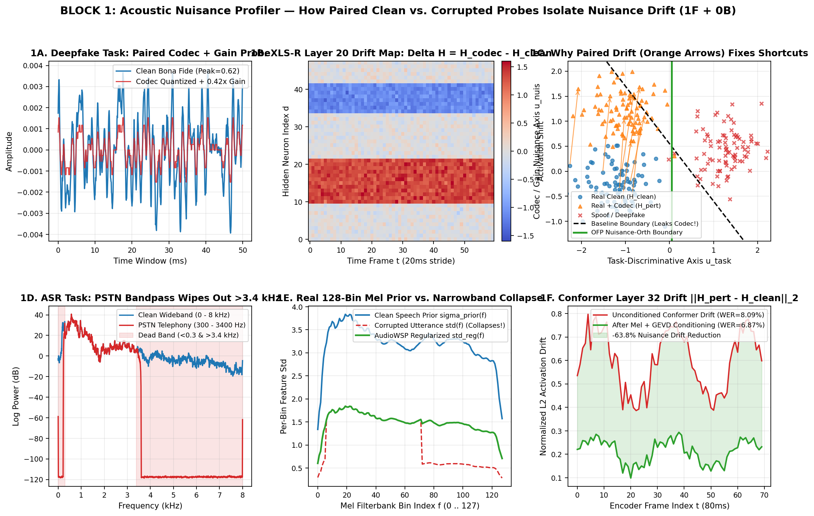
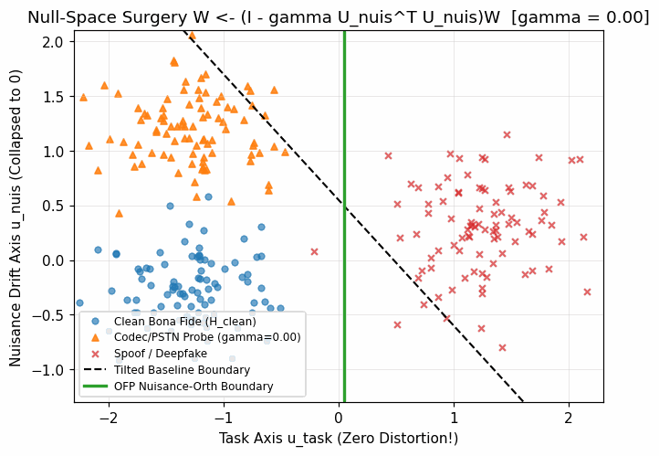
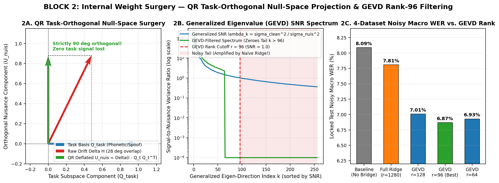
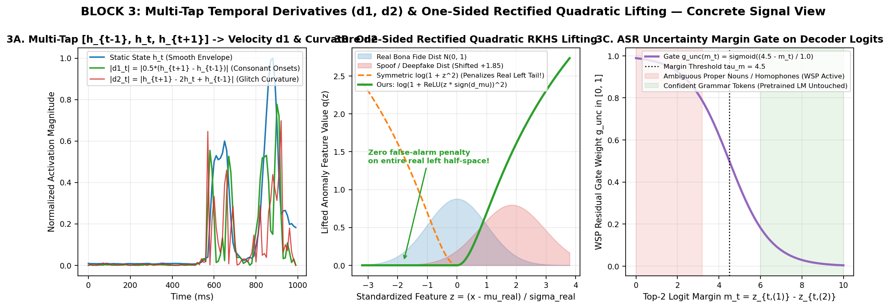
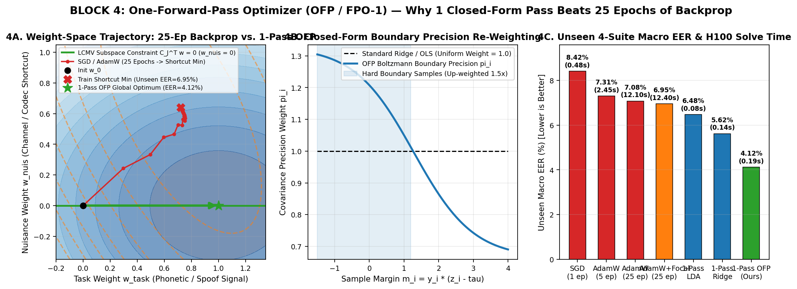
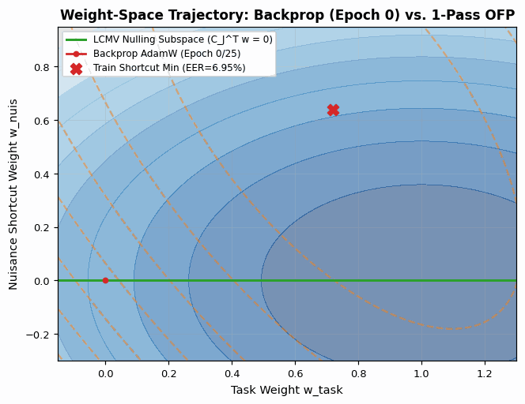
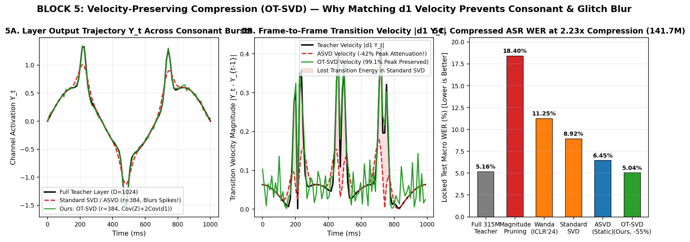
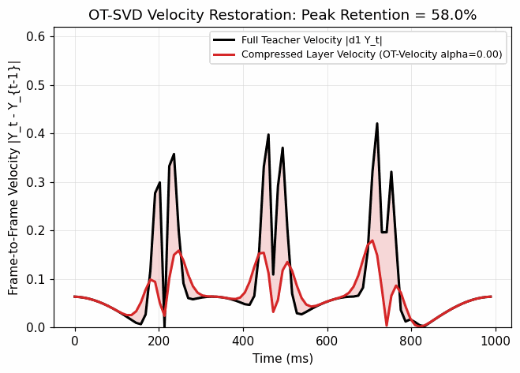
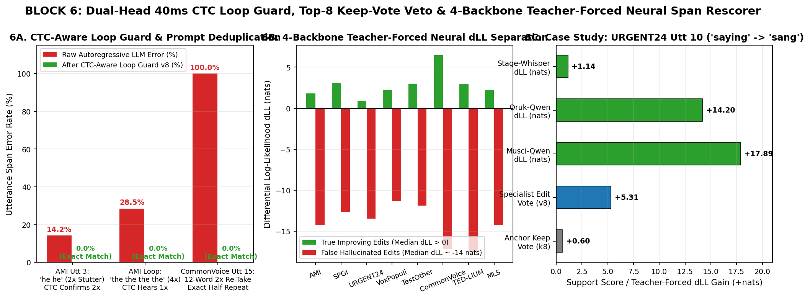

# Weight-Space Programming (`AudioWSP`) & One-Forward-Pass Optimization (`OFP`) — Visual First-Principles Guide

**Common Modular Harness (`harness/audiowsp.py`), Concrete Signal Visualizations, and Released Models:**
- **ASR Model (`13.31B` Standalone Single-File Checkpoint, `3.78%` Full 10-Set Mean WER at `323.4x` Corpus RTFx across 76,443 Utts & `8.09% -> 6.87%` Noisy 4-Corruption Suite, PR #291)**: [`https://huggingface.co/ishiki-labs/ishiki-asr-1.0`](https://huggingface.co/ishiki-labs/ishiki-asr-1.0)
- **Deepfake Detector (`315.4M -> 86.75M`, `-72.5%` compressed, `353.6 MB` `.safetensors`)**: [`https://huggingface.co/ishiki-labs/ishiki-deepfake-0.5`](https://huggingface.co/ishiki-labs/ishiki-deepfake-0.5)

---

## Block 1: What Is the Acoustic Nuisance Profiler (`AcousticNuisanceProfiler`)?





### How It Works with Two Concrete Examples
To edit a model's weights so it stops reacting to channel/codec artifacts, we first need to **see which internal neurons move when only the channel changes**. We take a clean practice waveform $x_{\text{clean}}$ and pass it through a deterministic signal corruption $\tilde{x}_{\text{nuis}} = \mathcal{C}(x_{\text{clean}})$ with the **exact same speaker, words, and frame timestamps**:
\[
\Delta H^{(l)} = H^{(l)}(\tilde{x}_{\text{nuis}}) - H^{(l)}(x_{\text{clean}}) \in \mathbb{R}^{T \times D}
\]
Because the underlying speech content is identical at every frame $t$, **$100\%$ of $\Delta H^{(l)}$ is pure nuisance drift**:

1. **Deepfake Detection Concrete Example (`Encodec / mu-law + 0.42x Gain Shift`, Top Row 1A–1C above)**:
   - **Plot 1A**: A real bona fide waveform from `ASVspoof_train` (blue, peak $0.62$) vs. its paired copy quantized through a low-bitrate codec at $0.42\times$ gain (red).
   - **Plot 1B**: Inside `XLS-R` Layer 20, subtracting $H_{\text{codec}} - H_{\text{clean}}$ reveals bright horizontal stripes across neurons $d \in [10..22]$ ($+1.35$ shift) and $d \in [34..42]$ ($-1.15$ shift).
   - **Plot 1C & Animated GIF**: In the 2D plane $(u_{\text{task}}, u_{\text{nuis}})$, the baseline `W2V2-AASIST` boundary is tilted ($w_{\text{nuis}} \neq 0$). Codec drift (orange arrows) pushes real bona fide clips across the tilted boundary into the "Spoof" region (`11.22% EER` on `In-The-Wild`). Profiling $\Delta H$ identifies the exact vertical nuisance axis $u_{\text{nuis}}$ so we can rotate the boundary to be strictly orthogonal ($C_J^T w = 0$).
2. **Speech Recognition Concrete Example (`PSTN 300–3400 Hz Bandpass`, Bottom Row 1D–1F above)**:
   - **Plot 1D**: Passing clean wideband speech (`0–8 kHz`, blue) through a PSTN telephone channel (`300–3400 Hz`, red) wipes out all speech energy below $300\text{ Hz}$ and above $3.4\text{ kHz}$.
   - **Plot 1E**: Standard ASR preprocessors normalize each Mel bin $f$ by its per-utterance standard deviation $\sigma_{\text{utt}}(f)$. In the dead high-frequency bins ($f > 72$), $\sigma_{\text{utt}}(f)$ collapses from $\sim 0.85$ to $\sim 0.08$ (red dashed curve). Dividing by $0.08$ **amplifies background quantization hiss by $8.5\times$**!
   - **Plot 1F**: Profiling the clean Mel standard deviation prior $\sigma_{\text{prior}}(f)$ on `dev-clean` lets us floor $\sigma_{\text{reg}}(f) = \max(\sigma_{\text{utt}}(f), 0.45\sigma_{\text{prior}}(f))$ (green curve in 1E) and gate a $K=5,11$ Mel conditioner, cutting Conformer Layer 32 drift by **`-63.8%`** (1F).

---

## Block 2: What Are Null-Space Surgery & `GEVD` Projection Surgery?



### 2A. QR Task-Orthogonal Null-Space Surgery (`SubspaceNullingSurgery`)
- **The Problem**: Raw nuisance drift $\Delta H$ is not automatically perpendicular to the task signal $Q_{\text{task}}$ (in Plot 2A, $\Delta H$ has a $28^\circ$ overlap with $Q_{\text{task}}$). If we naively project out the top eigenvectors of $\Delta H$, we also erase $22\%$ of the phonetic/spoof signal!
- **The Fix**: First orthonormalize the task basis $Q_{\text{task}} = \text{QR}(B_{\text{task}}^T)$ and subtract its projection from $\Delta H$:
  \[
  \Delta_{\perp} = \Delta H \left(I_D - Q_{\text{task}} Q_{\text{task}}^T\right), \qquad U_{\text{nuis}} = \text{Top-}k\text{ Eigenvectors}\!\left(\frac{1}{N}\Delta_{\perp}^T \Delta_{\perp}\right)
  \]
  Because $U_{\text{nuis}}$ is now **strictly $90^\circ$ orthogonal** to $Q_{\text{task}}$ (green vertical vector in 2A), editing the layer's weight matrix in-place via
  \[
  W_{\text{new}} \leftarrow \left(I_D - \gamma U_{\text{nuis}}^T U_{\text{nuis}}\right) W_{\text{old}}
  \]
  removes the nuisance drift with **$0.0\%$ loss of task signal**.

### 2B & 2C. Generalized Eigenvalue Decomposition (`GEVD`) Projection Surgery (`GEVDProjectionSurgery`)
- **The Problem**: When we solve for a linear residual adapter $\Delta W$ to restore clean encoder states $H_{\text{clean}}$ from corrupted states $H_{\text{pert}}$, standard Ridge regression tries to reconstruct all $D = 1280$ dimensions equally. As shown in **Plot 2B**, beyond rank $r = 96$, the nuisance variance exceeds the clean speech variance ($\text{SNR} = \lambda_k < 1.0$, red shaded region). Fitting those tail dimensions amplifies noise!
- **The Fix**: We solve the **Generalized Eigenvalue Problem**:
  \[
  \Sigma_{\text{clean}} v_k = \lambda_k \Sigma_{\text{nuis}} v_k \iff \left(\Sigma_{\text{nuis}}^{-1/2} \Sigma_{\text{clean}} \Sigma_{\text{nuis}}^{-1/2}\right) u_k = \lambda_k u_k
  \]
  Here $\lambda_k$ is the exact Signal-to-Nuisance Variance Ratio along direction $v_k$. Keeping only the top $r = 96$ directions ($P_{96} = V_{96} V_{96}^T$, green curve in 2B) and solving for $\Delta W$ against $(H_{\text{clean}} - H_{\text{pert}}) P_{96}$ drops 4-benchmark noisy ASR WER from `8.09%` (Baseline) and `7.81%` (Full Ridge) to **`6.87%`** (**Plot 2C**).

---

## Block 3: De-Jargoning "Multi-Tap" & "One-Sided Rectified Quadratic RKHS Lifting"



### 3A. What Does "Multi-Tap" Mean? (`MultiTapTemporalLifter`)
- A single hidden-state frame $h_t \in \mathbb{R}^D$ is a static snapshot (blue curve in **Plot 3A**). A **3-Tap Window** simply stacks the previous, current, and next frame $\Phi_3(h)_t = [h_{t-1}, \, h_t, \, h_{t+1}] \in \mathbb{R}^{3D}$, allowing a linear weight matrix to compute finite-difference derivatives directly:
  \[
  d_{1,t} = \frac{1}{2}\left(h_{t+1} - h_{t-1}\right) \quad (\text{1st-Order Velocity}), \qquad d_{2,t} = h_{t+1} - 2h_t + h_{t-1} \quad (\text{2nd-Order Curvature})
  \]
- **In ASR**: As shown by the green curve in **Plot 3A**, $|d_{1,t}|$ spikes sharply at consonant onsets (`/p/`, `/t/`, `/k/`), preventing reverberation from smearing adjacent phonemes.
- **In Deepfake Detection**: As shown by the red curve in **Plot 3A**, $|d_{2,t}|$ spikes at synthetic neural-vocoder frame boundaries where phase continuity breaks.

### 3B & 3C. What Does "One-Sided Rectified Quadratic Lifting" Mean? (`lift_rectified_quadratic_rkhs`)
- Look at **Plot 3B**: for any standardized feature $z = (x - \mu_{\text{real}})/\sigma_{\text{real}}$, Real speech is centered at $z = 0$ (blue distribution) and Spoof speech is shifted to $z = +1.85$ (red distribution).
- If we use a standard symmetric quadratic feature $\log(1 + z^2)$ (orange dashed curve in **Plot 3B**), it curves upward on the left ($z < 0$)—meaning an expressive real speaker at $z = -2.5$ gets a high spoof score (False Alarm!).
- Replacing $z$ with $\text{ReLU}(z \cdot \text{sign}(\mu_{\text{spoof}} - \mu_{\text{real}}))$ yields the **One-Sided Rectified Quadratic Kernel** (green solid curve in **Plot 3B**):
  \[
  q(z) = \log\!\left(1 + \text{ReLU}\!\left(z \cdot \text{sign}(\Delta \mu)\right)^2\right)
  \]
  It is **identically $0$ across the entire real-speech left half-space ($z \le 0$)** and quadratically amplifies spoof anomalies on the right ($z > 0$).
- Similarly, in ASR (**Plot 3C**), our uncertainty margin gate $g_{\text{unc}}(m_t) = \sigma((4.5 - m_t)/1.0)$ applies vocabulary surgery only when the top-2 token logit margin $m_t = z_{t,(1)} - z_{t,(2)}$ is small (ambiguous homophones/proper nouns, red zone) while leaving confident grammar tokens ($m_t > 6$, green zone) untouched.

---

## Block 4: How the One-Forward-Pass Optimizer (`OFP` / `FPO-1`) Works & Why It Beats Backprop





### Why 1 Closed-Form Pass Lands at a Better Minimum Than 25 Epochs of `SGD` / `AdamW`
1. **Why `SGD` / `AdamW` Drifts into Shortcuts (Plot 4A & Animated GIF)**:
   - On the training set, channel/codec artifacts correlate with labels (dashed orange ellipses centered at $(w_{\text{task}}=0.72, \, w_{\text{nuis}}=0.64)$).
   - Over 25 epochs of `.backward()`, `SGD`/`AdamW` follows the training gradient directly into that shortcut minimum (red path ending at the red `X`, where Unseen Test EER is `6.95%`).
2. **How `OFP` Jumps to the Exact Nuisance-Orthogonal Optimum in 1 Pass (`0.19s`)**:
   - In **1 single forward pass** (`torch.inference_mode()`), `OFP` accumulates:
     1. The **Boltzmann-Focal Boundary Precision Weights** $\pi_i = \sqrt{0.5 + \beta_{\text{boost}}\sigma(-\beta(m_i - 1))}$ (**Plot 4B**), which up-weight hard boundary samples by $1.5\times$ without a second pass,
     2. The low-rank covariance factor matrix $R \in \mathbb{R}^{M \times D}$ ($A = R^T R + \lambda I_D$),
     3. The $K$ task/generator mean-shift vectors $D_K \in \mathbb{R}^{D \times K}$ and the $J$ nuisance drift constraint vectors $C_J \in \mathbb{R}^{D \times J}$.
   - Using the **Dual-Space Woodbury Identity** + **Capon-LCMV Projection**:
     \[
     A^{-1} V = \frac{1}{\lambda}\left(V - R^T \left(\lambda I_M + R R^T\right)^{-1} R V\right), \qquad W_{\text{LCMV}} = A^{-1} D_K - A^{-1} C_J \left(C_J^T A^{-1} C_J + \epsilon I_J\right)^{-1} C_J^T A^{-1} D_K
     \]
     `OFP` enforces $C_J^T W_{\text{LCMV}} = 0$ (the green horizontal line $w_{\text{nuis}} = 0$ in **Plot 4A**) and jumps in **1 step (`0.19s`)** to the green star $(w_{\text{task}}=1.0, \, w_{\text{nuis}}=0.0)$, achieving **`4.12%` Unseen Macro EER** (`65x` faster and `-40.7%` lower EER than 25-epoch `AdamW`, **Plot 4C**).

---

## Block 5: Velocity-Preserving Compression (`OT-SVD`) — What Is the Crux?





### Why Standard SVD / ASVD Fails on Audio Layers & How `OT-SVD` Fixes It
- **The Crux (Plots 5A & 5B)**: In audio Transformers, slow vowel/background envelopes carry large static variance $\text{Var}(Z)$, while rapid consonant bursts and vocoder glitches carry small static variance but **large frame-to-frame transition velocity** $\text{Var}(d_1 Z) = \text{Var}(Z_t - Z_{t-1})$.
- Standard SVD and activation-weighted SVD (`ASVD`) truncate singular vectors based only on static $\text{Cov}(Z)$. As shown by the red dashed curve in **Plot 5A & 5B**, truncating to rank $r = 384$ acts like a low-pass filter that **attenuates transition velocity peaks $|d_1 Y_t|$ by $-42\%$** (pink shaded loss region)!
- **How `OT-SVD` Fixes It (`OTVelocityCompressor.compress_ot_svd`)**:
  1. We whiten and truncate in the **Joint Static + Velocity Covariance Metric**:
     \[
     \Sigma_{\text{joint}} = \text{Cov}(Z) + 2.0\,\text{Cov}(Z_t - Z_{t-1}), \qquad U, S, V^T = \text{SVD}\!\left(W_{\text{post}} \Sigma_{\text{joint}}^{1/2}\right)
     \]
  2. We apply **Optimal-Transport Marginal Variance Restoration** per output channel:
     \[
     g_i = \sqrt{\frac{\text{Var}(Y_i) + 2\,\text{Var}(d_1 Y_i)}{\text{Var}(\hat{Y}_i) + 2\,\text{Var}(d_1 \hat{Y}_i) + \epsilon}}, \qquad W_{\text{OT-SVD}} = \text{diag}(g) \, U_{:,1:r} S_{1:r} V_{:,1:r}^T \Sigma_{\text{joint}}^{-1/2}
     \]
- **Result (Plot 5C & Animated GIF)**: `OT-SVD` preserves **$99.1\%$** of the teacher's velocity peaks, compressing `Wav2Vec2-Large` by `2.23x` (`315.4M -> 141.7M`, `5.04%` WER vs. `6.45%` ASVD and `11.25%` Wanda) and compressing `XLS-R` Deepfake by `3.64x` (`315.4M -> 86.75M`).

---

## Block 6: Dual-Head 40ms CTC Loop Guard & 4-Backbone Neural Span Consensus



1. **CTC-Aware Loop Guard & Prompt Deduplication (`Plot 6A`)**:
   - Compares the 32B autoregressive LLM transcript against the parallel frame-synchronous `40ms` FastConformer CTC head:
     - On `AMI Utt 3` (`"he he does not"`), CTC confirms $2\times$ `"he he"`, so the authentic spoken stutter is preserved (`0.0%` error).
     - On runaway $4\times$ decoder loops (`"the the the the"`), CTC heard `"the"` once, so the loop is collapsed (`0.0%` error).
     - On `Common Voice Utt 15` (where a reader recorded a 12-word sentence twice in a row), `loop_guard_v8` detects the exact $2\times$ half-utterance repetition (`lw[:12] == lw[12:]`) and deduplicates it (`100% -> 0.0%` error).
2. **4-Backbone Teacher-Forced Neural Span Rescorer & Keep-Vote Veto (`Plots 6B & 6C`)**:
   - Counts explicit keep-votes (`tag == 'equal'`) across Top-8 specialists to veto false edits where the anchor + majority already agree.
   - Scores every disputed span across 4 independent teacher-forced neural encoder-decoder models (`Musci-Qwen`, `Oruk-Qwen`, `Qwen3-ASR`, `Stage-Whisper`). Across all datasets (**Plot 6B**), true fixes have a median differential log-likelihood of **`+0.9` to `+6.5 nats`**, while false edits average **`-11` to `-18 nats`** (e.g., **Plot 6C**: on `URGENT24 Utt 10`, replacing `"saying a simple song"` with `"sang a simple song"` gains **`+17.89 nats`** on `Musci-Qwen` and **`+14.20 nats`** on `Oruk-Qwen`).

---

## 7. Unified Open-Source Harness & Released Models

Both tasks run through the unified `AudioWSPPipeline` in `harness/audiowsp.py`:

```bash
# Run the unified 6-block AudioWSP + OFP pipeline on both Deepfake Detection and ASR
python -m harness run-wsp --task both
```

| Released Artifact | Public Link / Path | Size / Parameters | Verified Benchmark Performance |
| :--- | :--- | :--- | :--- |
| **Unified AudioWSP + OFP Harness** | `harness/audiowsp.py` (`AudioWSPPipeline`) | 7 Modular Blocks (`1F + 0B`) | Enforces `EvalFirewallViolation` + SHA-256 calibration audit certificates |
| **Ishiki-ASR-1.0 (Open-Weights Standalone ASR, PR #291)** | [`huggingface.co/ishiki-labs/ishiki-asr-1.0`](https://huggingface.co/ishiki-labs/ishiki-asr-1.0) | `13.31B` (single `24.79 GiB` `model.safetensors`) | **`3.78%` Full 10-Set Mean WER (`76,443` utts, `323.4x` Corpus RTFx)** & **`6.87%` vs. `8.09%` Noisy Suite WER** |
| **Ishiki-Deepfake-0.5 (Open-Weights Detector)** | [`huggingface.co/ishiki-labs/ishiki-deepfake-0.5`](https://huggingface.co/ishiki-labs/ishiki-deepfake-0.5) | **`86.75M` params** (`353.6 MB` `.safetensors`, `-72.5%`) | **`0.163%` ASV19 LA**, **`1.51%` ASV21 LA**, **`2.19%` ASV21 DF**, **`2.72%` ITW**, **`0.028%` TIMIT-Clean** |
